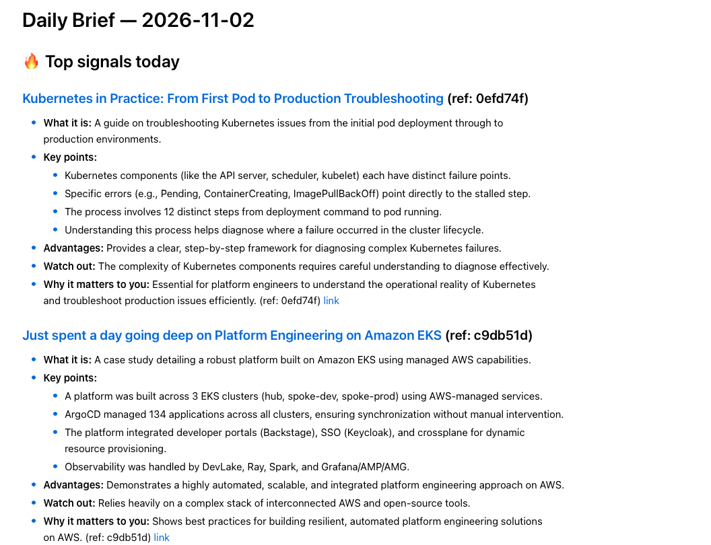

# daily-brief

A local, privacy-first daily briefing agent. It pulls from Hacker News, Reddit, RSS, GitHub (and optionally your own LinkedIn session), drops the noise, ranks what's left, and has an LLM write a short Markdown brief with a link for every item.

```
sources ─► dedupe ─► filter ─► score (+ your feedback) ─► LLM ─► verify links ─► brief.md
```

- **Local by default.** Data stays in `./data`. Summaries come from Ollama on your machine.
- **No account needed to try it.** `daily-brief run --sample --model none` works offline with no keys.
- **Learns from you.** Vote 👍/👎 on items and the ranking adapts.
- **Reading-list triage.** Tags saved items and flags stale ones.
- **Cost-aware.** Prints a token and cost report after every run.

## Example output

<p align="center">
  
</p>

The same content in raw Markdown:

```markdown
### [Show HN: OmniDiff – Opensource, super fast, content aware Git difftool, in Rust](https://github.com/ivankovic/omnidiff) · hn
- **What it is:** An open-source tool written in Rust that performs fast diffs across code, config and images.
- **Advantages:** Extremely fast performance for complex diff operations.
- **Watch out:** It is currently in v0.3.0 and still under development.
- **Why it matters to you:** Provides a high-performance diffing utility. (ref: fac8013)
```

Full file: [examples/real_brief_gemma4.md](examples/real_brief_gemma4.md). Not into AWS/DevOps? Start from [examples/config.general.yaml](examples/config.general.yaml).

## Quick start

```bash
git clone <this repo> && cd daily-brief
python3 -m venv .venv && source .venv/bin/activate
pip install -e .

daily-brief run --sample --model none    # try it with bundled fake data
daily-brief init                         # write a starter config.yaml, then edit it
daily-brief doctor                       # check your setup
ollama pull gemma4:e2b                   # local LLM
daily-brief run                          # writes data/briefs/YYYY-MM-DD.md
daily-brief schedule install --time 08:00
```

Optional extras: `pip install -e ".[claude]"`, `".[openai]"`, `".[gemini]"`, `".[linkedin]"` or `".[all]"`.

### Install Ollama

Ollama runs the LLM locally. Skip this if you use a cloud model or `--model none`.

**macOS**

```bash
brew install ollama        # or download the app from https://ollama.com/download
brew services start ollama # the desktop app starts the server for you
```

**Windows**

Download and run the installer from [ollama.com/download](https://ollama.com/download), or:

```powershell
winget install Ollama.Ollama
```

On Windows, activate the virtualenv with `.venv\Scripts\activate` instead of `source .venv/bin/activate`.

**Verify**

```bash
ollama --version
ollama pull gemma4:e2b
daily-brief doctor
```

## Commands

| Command | Purpose |
|---|---|
| `run` | Collect, process and write the brief. Flags: `--model`, `--dry-run`, `--estimate`, `--force`, `--sample`, `--redact`, `--only` |
| `init` | Write a starter `config.yaml` |
| `doctor` | Check Python, config, LLM, optional deps |
| `feedback up\|down <ref…>` | Vote on items; also `list`, `weights`, `reset` |
| `backlog …` | Reading-list triage (`list`, `stale`, `summary`, `read`, `archive`, `tag`, `add`) |
| `schedule …` | Daily run via launchd, systemd or cron |
| `cost` | Token and cost history |
| `linkedin login\|status` | Session helpers for the opt-in LinkedIn source |

## Sources

| Source | Needs | Notes |
|---|---|---|
| `hackernews` | nothing | Front page via Algolia API |
| `reddit` | nothing | Top of day via public feeds; anonymous requests may be throttled |
| `rss` | nothing | Any RSS or Atom feed |
| `github_trending` | optional `GITHUB_TOKEN` | New repos gaining stars |
| `linkedin` | opt-in | Your own session. Read [docs/linkedin.md](docs/linkedin.md) first |

If one source fails, the brief is still written and the footer says which one failed.

## LLMs

Set with `--model` or `llm.model`.

| Spec | Needs |
|---|---|
| `none` | Nothing. Deterministic digest |
| `ollama`, `ollama:<model>` | [Ollama](https://ollama.com) running |
| `claude`, `claude:<model>` | `ANTHROPIC_API_KEY` |
| `gpt4o`, `openai:<model>` | `OPENAI_API_KEY` |
| `gemini`, `gemini:<model>` | `GOOGLE_API_KEY` |

Ollama is the tested path. The cloud adapters are covered by mocks only, so bug reports are welcome. If the LLM is down, `llm.fallback_offline` still writes a digest.

**Safety.** Scraped posts are treated as untrusted data, and any URL in the model's output that isn't in your source data is stripped. Card headings, duplicates and refs are repaired after the model answers.

**Cost.** `run --estimate` shows an upper-bound cost before spending anything. Set `llm.pricing` for models without built-in prices.

**Privacy.** With a cloud LLM, posts are sent to that provider. `--redact` pseudonymises authors and hides your profile (best effort). Prefer Ollama for sensitive content.

## Feedback and triage

Each brief ends with a **Sources index** of short refs.

```bash
daily-brief feedback up a1b2c3d        # boost similar authors, domains, topics
daily-brief feedback down 55aa66b
daily-brief backlog stale              # unread for 30+ days
```

## Configuration

`daily-brief init` writes [config.yaml](src/daily_brief/config.example.yaml). Omitted values use defaults. Secrets go in `.env` (see `.env.example`), never in YAML.

Search order: `--config`, `$DAILY_BRIEF_CONFIG`, `./config.yaml`, `~/.config/daily-brief/config.yaml`.

## Scheduling

`daily-brief schedule install --time 08:00` sets up launchd (macOS) or a systemd timer (Linux), or prints a cron line. Runs are idempotent per day, so catch-ups never duplicate. Use `--force` to regenerate.

## Architecture

A single pipeline: collect, process, synthesise, verify, save. Each stage is isolated, so a failing source or LLM never blocks the brief. See [docs/architecture.md](docs/architecture.md) for the full diagram.

## Development

```bash
pip install -e ".[dev]"
ruff check . && pytest
```

See [CONTRIBUTING.md](CONTRIBUTING.md) and [SECURITY.md](SECURITY.md).

## Roadmap

Ideas for further development. Contributions are welcome, see [CONTRIBUTING.md](CONTRIBUTING.md).

- **Delivery:** send the brief by email, Slack, Telegram or a push notification, not just a Markdown file.
- **More sources:** Mastodon, Lobsters, arXiv, YouTube channels, newsletters, Bluesky.
- **Windows scheduling:** add Task Scheduler support (today: launchd, systemd, cron).
- **Smarter ranking:** embedding-based similarity to items you liked, instead of heuristics only.
- **Live-tested cloud adapters:** run Claude, OpenAI and Gemini end to end (today covered by mocks).
- **Web UI:** browse past briefs, vote and manage the backlog in a browser.
- **Multiple profiles:** separate configs and histories, such as "work" and "personal".
- **Packaging:** a Docker image and a PyPI release for one-line install.
- **Extra outputs:** HTML, RSS feed or audio digest of the brief.
- **Evaluation:** a small benchmark to compare local models on brief quality.

## License

MIT. See [LICENSE](LICENSE). Not affiliated with LinkedIn, Reddit, Y Combinator, GitHub or any LLM provider.
