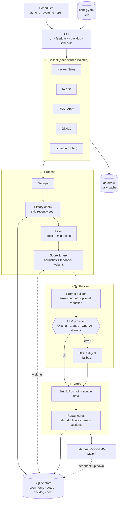

# Architecture

`daily-brief run` is a single linear pipeline. Each stage is isolated, so a failing source or LLM never stops the brief from being written.

## Stages

| Stage | What happens | Code |
|---|---|---|
| Collect | Every enabled source runs on its own. Results are cached per day in `data/raw`. | `sources/` |
| Process | Dedupe by URL, drop recently seen items, filter by topic, rank with heuristics plus your votes. | `processing/` |
| Synthesise | Build a token-budgeted prompt, call the chosen LLM, or fall back to the offline digest. | `llm/prompt.py`, `llm/providers.py` |
| Verify | Remove any URL not in the source data, then fix refs, duplicate cards and empty sections. | `llm/safety.py` |
| Save | Write the brief, then record seen items, token usage and cost. | `store.py` |

Orchestration lives in [pipeline.py](../src/daily_brief/pipeline.py).
